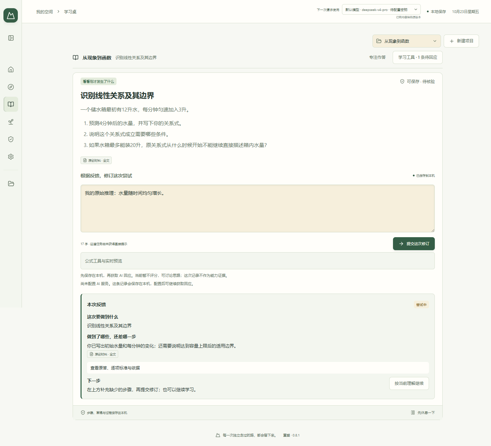
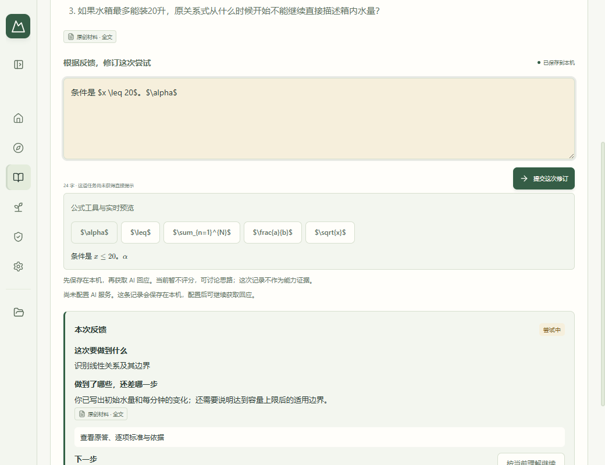

# 重登 · 个人 AI 学习空间

[下载 Windows x64 安装包（0.8.1 预发行版）](https://github.com/chenwy1020/reclimb/releases/download/v0.8.1/Reclimb-Setup-0.8.1.exe) · [发布说明与校验文件](https://github.com/chenwy1020/reclimb/releases/tag/v0.8.1) · [MIT 许可证](LICENSE)

本分支源码版本：**0.5.3 预发行版**。iPad 网页可上传 Goodnotes 等软件的作答截图，接入原稿保存、识别核对和原位追问。保留网页手写。备份格式升级为 10，多电脑接续请同步升级。

Windows 上的个人学习应用，用于阅读不同书籍、课程和文章，保留尝试、帮助和能力证据。Electron 主进程管理本地资料与模型调用，React 呈现学习桌，SQLite 保存长期档案。

本仓库自有代码采用 [MIT 许可证](LICENSE)。第三方组件保留各自的许可证和版权声明。项目暂不发布公共 npm 包。

[使用说明](docs/使用说明-0.5.3.md) · [验证记录](docs/验证记录-0.5.3.md) · [0.5.0 说明](docs/使用说明-0.5.0.md) · [手写实施计划](docs/plans/2026-09-14-ipad-handwriting.md) · [设计原则](docs/设计原则.md) · [开发与扩展](docs/开发与扩展-0.4.2.md)

## 安装与使用

最新发布的安装包为 **0.8.1 设置布局补丁预发行版**。本分支的源码与下方开发说明仍对应 0.5.3。

Windows x64 最新安装包为 [Reclimb-Setup-0.8.1.exe](https://github.com/chenwy1020/reclimb/releases/download/v0.8.1/Reclimb-Setup-0.8.1.exe)（约 141 MiB，**预发行版**）。升级前保留完整备份并退出旧版，再运行安装包。安装包包含运行环境，普通使用者无需安装开发工具。

安装包未签名，Windows 可能显示安全提示。请从[本仓库发布页](https://github.com/chenwy1020/reclimb/releases/tag/v0.8.1)下载，并用随附的 [SHA256 校验文件](https://github.com/chenwy1020/reclimb/releases/download/v0.8.1/SHA256SUMS-0.8.1.txt)核对下载文件。

iPad 无需安装 App；配对页面在可信的同一局域网内使用，固定端口 47149，HTTP 连接不加密，程序不会自动修改防火墙。已打开的页面可断网续写；浏览器清理、IP 地址改变、锁屏回收和离线冷启动仍有边界，重要原稿请下载备份。真实 Apple Pencil 与 Safari 体验需实机验收，当前验收状态见验证记录。

## 项目截图

以下为 **0.8.1 安装包**的界面，使用原创演示材料与模拟响应，仅展示界面，不代表真实模型评测结果。

### 学习台



### 数学输入与实时预览



## 开发

使用 Windows x64 与 Node.js 24，并按锁文件安装依赖：

```powershell
npm ci
node node_modules/electron/install.js
$env:RECLIMB_DATA_DIR = Join-Path $PWD '.local-test-data'
npm run dev
```

开发和验收使用独立资料目录，不指向正在学习的档案。

```powershell
npm run typecheck
npm run test:patch
npm run build
npm run test:desktop
npm run package
npm run verify:package
```

安装包包含运行环境，普通使用者无需安装开发工具。完整备份包含模型配置名称、接口和价格信息，不包含任何服务密钥；每位使用者自行配置服务与预算，资料保存在各自电脑。

常规桌面检查默认使用自制 PDF 和本机模拟服务，不需要私人教材或真实 AI 密钥。0.5.2 为小版本，Windows CI 执行类型检查、声明的针对性测试、构建和本版桌面流程；新回归已纳入 `npm run test:full`。版本变化而未明确配置小修范围时，自动回到全量。

## 设计原则

必要的摩擦应来自亲自思考、重构和迁移。系统错误、保存失败、低水平重复或反复维护 AI 的逻辑不属于学习者应该承担的困难。路线是一份可追溯的暂定判断，不是目录或闯关表；选择更快或更强的模型也不构成能力证据。题目核验、推进规则与能力证据管理仍不能代替真实教学效果的观察。

本仓库包含源码、通用测试和原创夹具。私人教材、学习档案、日志、凭据及个人验收账目不进入 Git。公开内容应逐项确认授权，并去除个人信息。
